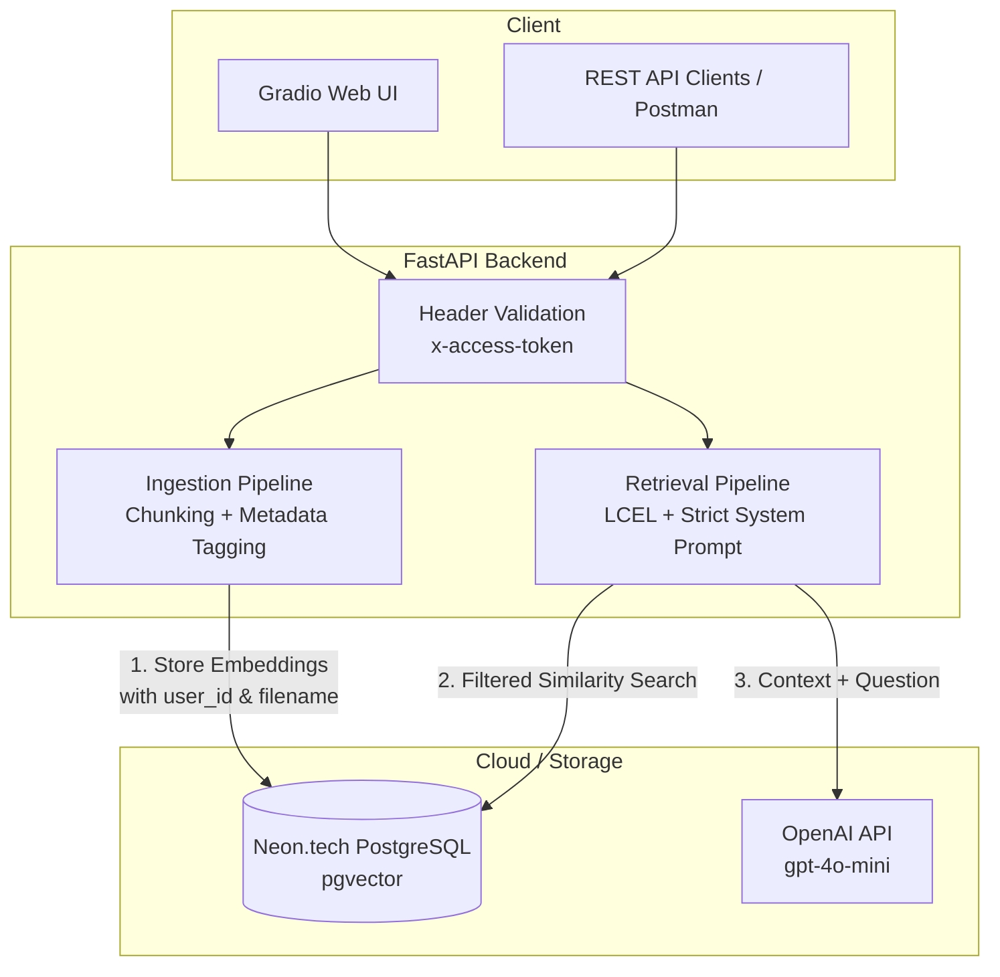

# Conversational RAG API with PGVector & FastAPI 🚀

A production-ready Retrieval-Augmented Generation (RAG) REST API built with **FastAPI**, **LangChain (LCEL)**, and **PostgreSQL (`pgvector`)**. It features strict multi-tenant data isolation, hallucination prevention, and a hybrid interface (REST endpoints + interactive Gradio UI).

🟢 **Live Demo:** https://rag-api-leqr.onrender.com
🔑 **Recruiter Access Token:** `PORTFOLIO2026` *(Required to test the live demo and protect OpenAI credits)*

---

## ✨ Key Features

* **Multi-Tenant Data Isolation:** Users are assigned unique session IDs (`localStorage` & API Headers). Document vectors are strictly tagged with `user_id` and `filename` metadata in pgvector, preventing context bleeding between different users' files.
* **Modern AI Orchestration (LCEL):** Built using LangChain Expression Language (LCEL) and LangChain Core components instead of legacy chains, providing a transparent and highly customizable pipeline.
* **Strict Hallucination Prevention:** System prompts are engineered with strict boundaries. If the context does not contain the answer, the LLM is forced to explicitly state it rather than guessing.
* **Cost-Optimized Models:** Powered by OpenAI's most efficient current models (`gpt-4o-mini` for generation and `text-embedding-3-small` for vectorization).
* **Hybrid Access:** Provides a visual Gradio chat interface at the root path (`/`) for non-technical users, while maintaining full Swagger UI interactive documentation at `/docs` for API integration.

## 🏗️ Architecture



## 🛠️ Tech Stack

* **Backend:** FastAPI, Pydantic, Uvicorn
* **AI Framework:** LangChain Core (LCEL), `langchain-postgres`, `langchain-openai`
* **Database:** PostgreSQL + `pgvector` extension (Dockerized for local, Neon.tech for production)
* **Frontend:** Gradio (Mounted on FastAPI)
* **Language:** Python 3.13

---

## 🚀 Local Quickstart

### 1. Clone & Configure
```bash
git clone [https://github.com/darksky-dev/rag-api-pgvector.git](https://github.com/darksky-dev/rag-api-pgvector.git)
cd rag-api-pgvector
cp .env.example .env
```
Add your `OPENAI_API_KEY` to the `.env` file. Leave `DATABASE_URL` commented out to use the local Docker database.

### 2. Start Vector Database (PostgreSQL + pgvector)
```bash
docker compose up -d
```

### 3. Install Dependencies & Run
```bash
python3 -m venv venv
source venv/bin/activate
pip install -r requirements.txt
uvicorn app.main:app --reload
```

* **Interactive Web UI:** `http://localhost:8000/`
* **Swagger API Docs:** `http://localhost:8000/docs`

---

## 📡 API Endpoints Overview

All endpoints require the following headers:
* `x-access-token`: `PORTFOLIO2026`
* `x-user-id`: Unique string identifying the user/session.

### `POST /upload/`
Accepts a `.pdf` file (`multipart/form-data`), splits it into 1000-character chunks (200 overlap), generates embeddings, and stores them in PostgreSQL tagged with the active `user_id`. Automatically overwrites previous vectors if the same filename is uploaded again to prevent duplication.

### `GET /documents/`
Returns a list of unique PDF filenames uploaded by the active `user_id`.

### `POST /chat/`
Performs a similarity search filtered strictly by the `user_id` and `filename`. Passes the retrieved context and optional `chat_history` to the LLM to generate an answer.

**Request Body:**
```json
{
  "question": "What are the main findings of the document?",
  "filename": "document.pdf",
  "chat_history": []
}
```